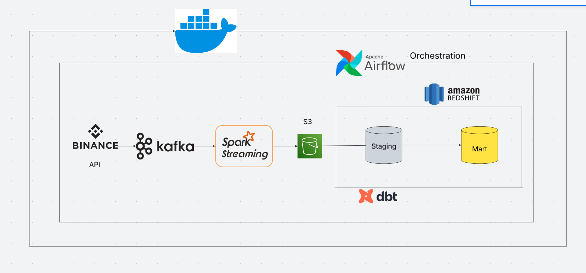
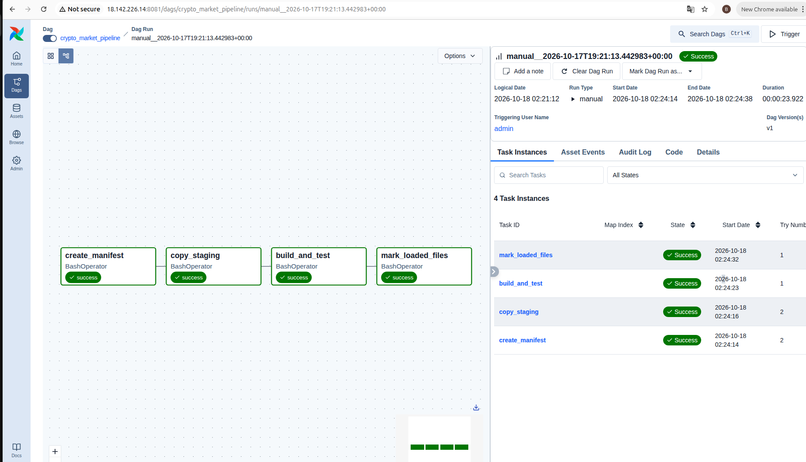

# Real-Time Crypto Market Data Pipeline & Financial Analytics Warehouse

Collect Binance Spot trades, calculate one-minute OHLCV/VWAP candles, and load a historical analytics table into Amazon Redshift Serverless.

Built with **Python · Kafka · Spark Structured Streaming · S3 · Airflow · dbt · Docker**, deployed on **EC2**. Power BI reporting is planned.

## Architecture



```text
Binance → Python producer → Kafka → Spark → S3 Parquet
                                              ↓
                           Airflow → Redshift staging → dbt → Analytics
```

- **Streaming:** Spark processes micro-batches every 30 seconds, aggregates one-minute candles, and finalizes them using a 10-second event-time watermark.
- **Warehouse:** Airflow runs hourly; dbt updates candles by `(symbol, window_start)` and tests duplicate keys and candle validity.
- **Storage:** Parquet is partitioned by UTC trade date. `etl.loaded_files` tracks successfully processed files.

Ten trading pairs are configured in [`config/market.json`](config/market.json): BTC, ETH, BNB, SOL, XRP, ADA, AVAX, LINK, UNI, and FET, all quoted in USDT.

## Project Structure

| Directory | Purpose |
| --- | --- |
| `producer/` | Binance WebSocket → Kafka |
| `spark/` | Streaming aggregation and Parquet output |
| `airflow/` | Hourly warehouse DAG |
| `redshift/` | Table DDL, manifest creation, and loader scripts |
| `dbt/` | Models, COPY macros, and data tests |
| `config/` | Market subscriptions |

## Setup

Requires Docker Engine, Docker Compose, an S3 bucket, and Redshift Serverless in the same AWS Region. Add `sudo` before Docker commands if required.

### 1. Configure the environment

```bash
git clone https://github.com/KhanhDo4804/Real-Time-Crypto-Market-Data-Pipeline.git
cd Real-Time-Crypto-Market-Data-Pipeline
test -f .env || cp .env.example .env
```

Edit `.env` with AWS authentication, S3 paths, and Redshift connection settings. Use a dedicated output/checkpoint pair, for example:

```dotenv
OHLCV_OUTPUT_PATH=s3a://YOUR_BUCKET/market/ohlcv_1m_ec2
OHLCV_CHECKPOINT_PATH=/opt/spark/checkpoints/ohlcv-ec2
REDSHIFT_SCHEMA=market
AIRFLOW_UID=1000
```

The current implementation uses IAM authentication. On EC2, prefer an instance IAM role and verify container access to its credentials. Never commit `.env`, private keys, or passwords.

### 2. Prepare AWS and Redshift

- Allow the application identity to list the bucket and read, write, and clean up objects under the output prefix.
- Grant the **Redshift COPY role** read access to both manifests and Parquet files, and associate it with the Redshift namespace.
- Update the role ARN in [`load_ohlcv_staging.sql`](dbt/macros/load_ohlcv_staging.sql); it is currently hardcoded, so changing `REDSHIFT_COPY_ROLE_ARN` alone is insufficient.
- Allow EC2 to reach Redshift on its configured port, normally `5439`, and grant the application/database users the required table and schema privileges.
- Run [`create_staging.sql`](redshift/create_staging.sql), [`create_etl_tables.sql`](redshift/create_etl_tables.sql), and [`create_main.sql`](redshift/create_main.sql) in Redshift Query Editor.

### 3. Prepare directories and Airflow login

```bash
mkdir -p data checkpoints airflow/logs dbt/target dbt/logs
sudo chown -R 1000:1000 data checkpoints
sudo chown -R 1000:0 airflow/logs dbt/target dbt/logs
sudo chmod -R u+rwX,g+rwX data checkpoints airflow/logs dbt/target dbt/logs
```

Create the Git-ignored file `airflow/passwords.json` with a strong password:

```json
{"admin": "REPLACE_WITH_A_STRONG_PASSWORD"}
```

```bash
sudo chown 1000:0 airflow/passwords.json
sudo chmod 600 airflow/passwords.json
docker compose -p crypto-market config --quiet
```

These permissions match the containers' current UID 1000 configuration; check ownership if your host uses different IDs.

### 4. Start the pipeline

```bash
docker compose -p crypto-market up -d --build producer spark
```

Kafka starts first, then `kafka-init` creates the topic with six partitions before producer and Spark start. Spark launches its job automatically.

Once S3 contains committed `_spark_metadata` batches and Parquet files, start Airflow:

```bash
docker compose -p crypto-market up -d --build airflow
```

Open **http://localhost:8081**, log in, and unpause **`crypto_market_pipeline`**. On EC2, use an SSH tunnel or restrict port `8081` to your client IP. Create `.env` and the password file separately on EC2.

## Airflow Workflow

```text
create_manifest → copy_staging → build_and_test → mark_loaded_files
```

The DAG runs at minute zero of every hour, allows one active run, and retries failed tasks up to three times. If no new committed files exist, it skips downstream processing.



## Operations

```bash
docker compose -p crypto-market ps -a
docker compose -p crypto-market logs -f --tail=50 producer spark airflow
docker compose -p crypto-market run --rm dbt debug
df -h /
docker system df
```

- Containers started with `-d` keep running after SSH disconnects. EC2 must remain running.
- Kafka, producer, and Spark have restart policies. Add `restart: unless-stopped` to the Airflow service if it should restart after a host reboot.
- Keep each output prefix paired with its checkpoint. A fresh checkpoint against an old S3 prefix can cause Spark to skip writes due to existing batch metadata.
- After editing `.env`, apply it with `docker compose -p crypto-market up -d --force-recreate spark airflow`; `restart` alone does not reload environment variables.
- Kafka retains raw trades for 24 hours or approximately 512 MiB per partition. Raw trades are not archived to S3.
- Docker images, Kafka, checkpoints, and logs still use local disk even with S3 output. Avoid `down -v` when preserving runtime volumes.

This is a single-host learning project: one Kafka broker, Spark `local[2]`, and Airflow standalone. Future work includes raw-trade archival, trade deduplication, late-data correction, monitoring, and Power BI dashboards.
